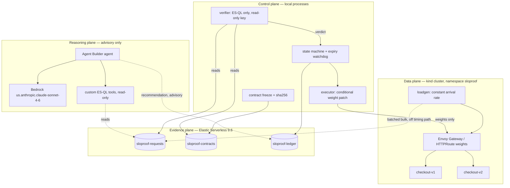

# SLOProof service architecture

Status: proposed architecture with a verified capability baseline, 18 September 2026. Sections marked **Verified** were probed against the actual credentials in `.env` on that date. Everything else is a design proposal, not a completed capability.

Companion documents: [DEMO_AND_SERVICE_REUSE.md](DEMO_AND_SERVICE_REUSE.md) for demo behavior, metrics, and the recovery contract; `JUDGING_CRITERIA.md` for scoring weights; `HACKATHON_PLAN.md` and `EKS_FAILURE_CANARY_PLAN.md` for the earlier EKS-first scope.

## 1. Verified capability baseline

These probes were read-only. They replace the open questions in the earlier plans about which services are actually reachable.

| Capability | Result | Architectural consequence |
|---|---|---|
| Elasticsearch | Serverless **9.6.0**, GCP `asia-south1`, empty cluster, unrestricted API key, ES\|QL `POST /_query` works | Evidence plane is ready. Serverless: no shard/replica tuning, use index templates and data streams |
| Kibana | 9.6.0, available | Dashboard and connector configuration available |
| **Elastic Agent Builder** | **Live.** `GET /api/agent_builder/agents` and `/tools` return 200; default `elastic-ai-agent` present; 37 builtin tools | Agent plane is configuration, not an integration build |
| Kibana `.bedrock` connector | **Enabled** | "Agent Builder backed by Bedrock" is one connector, not custom glue |
| Bedrock runtime | Works **only via inference profiles**. `us.anthropic.claude-sonnet-4-6` returned a completion; bare `anthropic.claude-sonnet-4-6` fails with `ValidationException` | Always use `us.`-prefixed model IDs |
| AWS identity | `assumed-role/WSParticipantRole/Participant` (Workshop Studio), region `us-west-2`, temporary session token present | No realistic IAM/VPC/ALB provisioning; credentials expire |
| EKS | `list-clusters` returns empty | No cluster exists; provisioning under this role is not a 4-hour bet |
| ECR | No repositories | Local image build, no registry push |
| SageMaker | Domain `amazon-bedrock-workshop`, `InService` | Exists but has no role in this architecture |
| Local tooling | Docker/OrbStack 29.4, kubectl 1.35.3, brew, go 1.25, python 3.14, node 22 | Cluster substrate available |
| Missing locally | `kind`, `k3d`, `helm`, `k6`, `hey` | Install `kind` + `helm`; write the load generator ourselves |
| Elastic RTT from this machine | ~100 ms total, ~35 ms connect (5 samples) | Bulk ingest off the request path is comfortable; measure index-visibility lag separately |
| **Hazard** | The only kubectl contexts are Azure clusters `dev_automatic_cluster` (current) and `genesis-prod-v2` | Every script must pin and assert its context. See §6 |

## 2. Decisions

| # | Decision | Rationale |
|---|---|---|
| D1 | **Local `kind` cluster** is the demo substrate, not EKS | A Workshop participant role cannot realistically create a cluster, node group, IAM roles, and an ALB inside the build window. Manifests stay portable so EKS remains an optional later target |
| D2 | **AWS depth comes from Bedrock**, not from AWS compute | Bedrock is verified working. Claiming AWS compute we do not run would be a false claim under Production Readiness |
| D3 | **Agent Builder + `.bedrock` connector** is the reasoning plane | Both verified present. This satisfies the two integrations the organizers showed interest in, through configuration |
| D4 | **One Go binary, one image, two Deployments**, fault profile from env | Identical code path for v1 and v2 makes the regression a config difference, and removes a second build from the critical path |
| D5 | **Gateway API `HTTPRoute` weights via Envoy Gateway**, behind a `RouteAdapter` interface | Weighted routing must be measured, not asserted. The adapter keeps the riskiest dependency swappable (§5) |
| D6 | **Client-observed outcomes → `_bulk`**, not OpenTelemetry | One ingestion path we control, captures timeouts and gateway failures that never reach the service, and no collector to debug |
| D7 | **Verifier is a separate process with a read-only key** | The promotion decision must be computationally and credentially separate from the thing that wants to promote. This is the core claim of the project |
| D8 | **Agent output is advisory and written to the ledger as `advisory`** | The agent recommends; the deterministic verifier decides. It has no write path and no executor access |

## 3. The four planes



### Plane 1 — data plane

One `POST /checkout` endpoint plus a separate health endpoint. Every response, including errors, carries serving version and request ID. Fault profile comes from a Deployment env var:

| Profile | Behavior | Used by |
|---|---|---|
| `healthy` | success, latency well under 300 ms at target load | v1 baseline and recovery candidate |
| `checkout-regression` | ~20% HTTP 500 plus 800 ms added latency, health probes stay green | v2 incident |
| `bad-recovery` | success but latency above 300 ms | v1 in the rejected-trial scenario |

Health probes must stay green during the regression so Kubernetes does not remove the failing version before the routing experiment runs. Fault activation belongs to the operator; the executor cannot change fault profiles, edit Deployments, or run shell commands.

### Plane 2 — evidence plane

| Index | Contents | Written by |
|---|---|---|
| `sloproof-requests` | one document per attempted request: `request_id` (as `_id`), `run_id`, start/end time, duration ms, HTTP outcome or timeout, serving version when known, `synthetic` and `warmup` flags | loadgen (ingest key) |
| `sloproof-contracts` | frozen criteria plus `sha256`, saved before the trial starts | controller |
| `sloproof-ledger` | routing receipts, exact ES\|QL queries and time ranges, measured values, verdicts and reasons, agent recommendations tagged `advisory` | controller |

Explicit mappings for date, numeric, and keyword fields before first ingest. `request_id` as the document `_id` so retries cannot double-count. Indexing stays outside request timing. Check item-level bulk errors, and reconcile each closed window's observed count against its searchable count before treating the window as complete.

### Plane 3 — control plane

State machine: `DETECTED → CONTRACT_FROZEN → TRIAL → VERIFYING → PROMOTING → RECOVERED`, with `REVERSING`, `REVERSED`, and `ESCALATED` as separate outcomes. Durable state in Elasticsearch, kept separate from the frozen contract.

The executor accepts typed actions only, validates contract and state, and patches weights on one named `HTTPRoute`, conditional on UID, `resourceVersion`, backend identities, and expected current weights. An unexpected route change records a conflict and escalates rather than overwriting.

The receipt records **two** timestamps: API acceptance, and data-plane-effective time derived from observed traffic. Observation windows anchor to the second one, never to the first and never to planner text.

### Plane 4 — reasoning plane

A Kibana `.bedrock` connector to `us-west-2` with `us.anthropic.claude-sonnet-4-6`, and an Agent Builder agent given custom parameterized ES\|QL tools: per-version success rate and p95 for a time range, observed traffic split, and evidence freshness. Tools are read-only and take validated parameters.

The agent returns a recommendation — action, target, weights, rationale, and the query IDs its claims rest on. That record goes to the ledger tagged `advisory`. It cannot write contracts, patch routes, or invoke the executor.

## 4. Trust boundaries

Four credentials, not one. The unrestricted key in `.env` is for setup only and must not be used by any runtime component.

| Actor | Elasticsearch | Cluster | Faults |
|---|---|---|---|
| Operator (human) | full | full | yes |
| loadgen (ingest key) | write `sloproof-requests` only | none | no |
| Verifier (verifier key) | **read-only** on requests and contracts | none | no |
| Controller / executor | write contracts and ledger, read requests | `get` + `patch` on one named `HTTPRoute` | no |
| Agent Builder agent | read-only through its tools | none | no |

Honest limits to state in the presentation: a contract hash is traceability, not privilege-enforced immutability; an operator-supervised controller is not an independent expiry watchdog; RBAC restricts resources and verbs but not individual fields, so weight-only mutation is enforced by executor validation.

## 5. Two interfaces that isolate the two real risks

The riskiest unknowns are the routing controller and the agent wiring. Both sit behind an interface so a failure costs a swap, not a rewrite.

| Interface | Primary | Fallback | Trigger |
|---|---|---|---|
| `RouteAdapter` | Envoy Gateway `HTTPRoute` weights | a weighted reverse proxy we own, same patch-weights API shape | Envoy Gateway not serving measured 90/10 within a 20-minute timebox |
| `Investigator` | Agent Builder agent with ES\|QL tools | direct Bedrock `Converse` with the same tools and the same recommendation JSON | Agent Builder tool wiring stalls |

Nothing in the control plane changes when either fallback is taken. Disclose whichever was used.

## 6. Cluster isolation — required

The current kubectl context is an Azure cluster named `dev_automatic_cluster`, alongside `genesis-prod-v2`. An unqualified `kubectl apply` from this machine targets someone's real infrastructure.

Every script must use a dedicated kubeconfig and assert the context before acting:

```bash
export KUBECONFIG="$PWD/.kube/sloproof.config"   # gitignored
kind create cluster --name sloproof --kubeconfig "$KUBECONFIG"
ctx="$(kubectl config current-context)"
[[ "$ctx" == "kind-sloproof" ]] || { echo "refusing: context is $ctx"; exit 1; }
```

No script may rely on the ambient current context.

## 7. Repository layout

```text
src/checkout/     Go service and fault profiles
src/loadgen/      constant-arrival-rate generator and bulk shipper
src/control/      contract, executor + route adapters, verifier, state machine, watchdog
k8s/              namespace, deployments, services, gateway, httproute
elastic/          index templates, scoped API key setup, ES|QL queries, agent tool definitions
demo/             up.sh, scenario-a.sh, scenario-b.sh, reset.sh, teardown.sh
docs/             this file, DEMO_AND_SERVICE_REUSE.md, screenshots, evidence exports
```

## 8. Ownership and sequence

Owners follow the split already proposed in `JUDGING_CRITERIA.md`. The three planes are independently buildable once the request document shape and the contract JSON schema are agreed — agree both in the first 15 minutes, because everything else depends on them.

| Owner | Plane | First deliverable | Blocking gate |
|---|---|---|---|
| Person 1 | Data plane | kind cluster, service, two deployments, measured 90/10 | Observed per-version counts prove the split |
| Person 2 | Evidence + control | mappings, scoped keys, bulk ingest, ES\|QL verifier, ledger | Healthy v1 passes and slow v1 fails on real evidence |
| Person 3 | Reasoning + presentation | `.bedrock` connector, agent tools, narrative, SUBMISSION.md | Agent cites measurements that match the verifier's numbers |

Order of completion: measured routing, then real evidence, then the verdict, then the agent, then the dashboard. Reserve the final 45 minutes for two clean rehearsals from reset and a backup recording.

## 9. Open items

| Item | Status | Recommendation |
|---|---|---|
| **Sarvam** | Key provisioned in `.env`, no plan uses it | Only after scenarios A and B are green: a spoken incident briefing, or a voice question routed to the agent. Keep it entirely out of the decision path |
| **SageMaker** | Workshop domain exists; no role in this design | Confirm with organizers whether it is mandatory before spending any time. There is no honest 4-hour use here |
| **Credential expiry** | AWS session token will expire | Confirm the expiry time early; the Bedrock connector fails when it lapses. Elastic key is unaffected |
| **EKS** | Not provisioned, not planned | Optional stretch only, and only if the local demo is already green and rehearsed |
| **Ingestion allowance** | Proposed 30 s after window close | Measure actual index-visibility lag in rehearsal and freeze the measured value |
