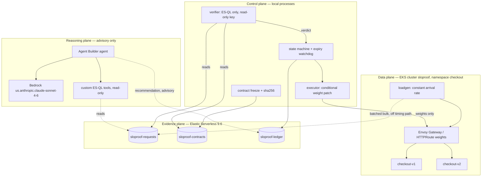

# SLOProof service architecture

Status: proposed architecture with a verified capability baseline, 18 September 2026. Sections marked **Verified** were probed against the actual credentials in `.env` on that date. Everything else is a design proposal, not a completed capability.

Companion documents: [DEMO_AND_SERVICE_REUSE.md](DEMO_AND_SERVICE_REUSE.md) for demo behavior, metrics, and the recovery contract; `JUDGING_CRITERIA.md` for scoring weights; `HACKATHON_PLAN.md` and `EKS_FAILURE_CANARY_PLAN.md` for the earlier EKS-first scope.

## 1. Verified capability baseline

These probes were read-only. They replace the open questions in the earlier plans about which services are actually reachable.

| Capability | Result | Architectural consequence |
|---|---|---|
| Elasticsearch | Serverless **9.6.0**, GCP `asia-south1`, empty cluster, unrestricted API key, ES\|QL `POST /_query` works | Evidence plane is ready. Serverless: no shard/replica tuning, use index templates and data streams |
| Kibana | 9.6.0, available | Dashboard and connector configuration available |
| **Elastic Agent Builder** | **Live.** `GET /api/agent_builder/agents` and `/tools` return 200; default `elastic-ai-agent` present; 37 builtin tools | Agent plane is configuration, not an integration build |
| Kibana `.bedrock` connector | **Enabled** | "Agent Builder backed by Bedrock" is one connector, not custom glue |
| Bedrock runtime | Works **only via inference profiles**. `us.anthropic.claude-sonnet-4-6` returned a completion; bare `anthropic.claude-sonnet-4-6` fails with `ValidationException` | Always use `us.`-prefixed model IDs |
| AWS identity | **Re-probed 18 September 2026:** IAM user `arn:aws:iam::<account-id>:user/sloproof` with **AdministratorAccess**, region `us-west-2`, long-lived key. This supersedes the earlier Workshop Studio `WSParticipantRole` probe | Full provisioning is available. EKS is a real option, not a stretch. See the credential warning below |
| EKS | `list-clusters` returns empty; account has a default VPC (`vpc-07842c3a16e997da1`, 172.31.0.0/16) in `us-west-2` | No cluster exists yet. Under AdministratorAccess, `eksctl` can create one. See D1 |
| ECR | No repositories | `scripts/push-ecr.sh` creates `sloproof-checkout` on first push and returns a digest to pin |
| SageMaker | Domain `amazon-bedrock-workshop`, `InService` | Exists but has no role in this architecture |
| Local tooling | Docker/OrbStack 29.4, kubectl 1.35.3, brew, go 1.25, python 3.14, node 22 | Cluster substrate available |
| Missing locally | `eksctl`, `helm`, `kind`, `k3d`, `k6`, `hey` | `brew install eksctl helm` before `scripts/eks-up.sh`. Write the load generator ourselves |
| Elastic RTT from this machine | ~100 ms total, ~35 ms connect (5 samples) | Bulk ingest off the request path is comfortable; measure index-visibility lag separately |
| **Hazard** | The only ambient kubectl contexts are Azure clusters `dev_automatic_cluster` (current) and `genesis-prod-v2` | Resolved: every script pins `KUBECONFIG` to a dedicated file and asserts the context. See §6 |
| **Hazard** | The AdministratorAccess key above was pasted into a chat transcript | Treat as compromised. Rotate it, then supply the replacement through `aws configure --profile sloproof`. No script reads or stores credentials |

## 2. Decisions

| # | Decision | Rationale |
|---|---|---|
| D1 | **Basic EKS** is the demo substrate — `eksctl`, one managed node group of 2x t3.medium across 2 AZs | **Revised 18 September 2026.** The original decision assumed a Workshop participant role. The credential actually in use has AdministratorAccess, so `eksctl create cluster` is viable. Budget 15-20 minutes for creation and run `scripts/eks-down.sh` afterwards: the control plane, nodes, and NLB all bill while they exist. Manifests stay portable, so `kind` remains the fallback if provisioning stalls |
| D2 | **AWS depth comes from Bedrock**, not from AWS compute | Bedrock is verified working. Claiming AWS compute we do not run would be a false claim under Production Readiness |
| D3 | **Agent Builder + `.bedrock` connector** is the reasoning plane | Both verified present. This satisfies the two integrations the organizers showed interest in, through configuration |
| D4 | **One Go binary, one image, two Deployments**, fault profile from env | Identical code path for v1 and v2 makes the regression a config difference, and removes a second build from the critical path |
| D5 | **Gateway API `HTTPRoute` weights via Envoy Gateway** (`gatewayClassName: eg`), behind a `RouteAdapter` interface | Weighted routing must be measured, not asserted. Envoy Gateway is one helm release that brings its own Gateway API CRDs and needs no IAM policy or IRSA, unlike the AWS Load Balancer Controller; its listener Service still gets an AWS NLB. Swapping to the AWS LBC for a true ALB changes only `GATEWAY_CLASS_NAME` |
| D6 | **Client-observed outcomes → `_bulk`**, not OpenTelemetry | One ingestion path we control, captures timeouts and gateway failures that never reach the service, and no collector to debug |
| D7 | **Verifier is a separate process with a read-only key** | The promotion decision must be computationally and credentially separate from the thing that wants to promote. This is the core claim of the project |
| D8 | **Agent output is advisory and written to the ledger as `advisory`** | The agent recommends; the deterministic verifier decides. It has no write path and no executor access |
| D9 | **The load generator runs inside the cluster**, not on the operator's laptop | Added 18 September 2026 after the first real run. Measuring from a laptop in India against a gateway in `us-west-2` added ~245 ms of round-trip to every sample, which pushed healthy v1 to a p95 of 339 ms and would have produced a FAILED verdict for a service that was performing correctly. The vantage point has to sit next to the service or the contract measures the demo operator's geography |

## 3. The four planes



### Plane 1 — data plane

One `POST /checkout` endpoint plus a separate health endpoint. Every response, including errors, carries serving version and request ID. Fault profile comes from a Deployment env var:

| Profile | Behavior | Used by |
|---|---|---|
| `healthy` | success, latency well under 300 ms at target load | v1 baseline and recovery candidate |
| `checkout-regression` | ~20% HTTP 500 plus 800 ms added latency, health probes stay green | v2 incident |
| `bad-recovery` | success but latency above 300 ms | v1 in the rejected-trial scenario |

Health probes must stay green during the regression so Kubernetes does not remove the failing version before the routing experiment runs. Fault activation belongs to the operator; the executor cannot change fault profiles, edit Deployments, or run shell commands.

### Plane 2 — evidence plane

| Index | Contents | Written by |
|---|---|---|
| `sloproof-requests` | one document per attempted request: `request_id` (as `_id`), `run_id`, start/end time, duration ms, HTTP outcome or timeout, serving version when known, `synthetic` and `warmup` flags | loadgen (ingest key) |
| `sloproof-contracts` | frozen criteria plus `sha256`, saved before the trial starts | controller |
| `sloproof-ledger` | routing receipts, exact ES\|QL queries and time ranges, measured values, verdicts and reasons, agent recommendations tagged `advisory` | controller |

Explicit mappings for date, numeric, and keyword fields before first ingest. `request_id` as the document `_id` so retries cannot double-count. Indexing stays outside request timing. Check item-level bulk errors, and reconcile each closed window's observed count against its searchable count before treating the window as complete.

### Plane 3 — control plane

State machine: `DETECTED → CONTRACT_FROZEN → TRIAL → VERIFYING → PROMOTING → RECOVERED`, with `REVERSING`, `REVERSED`, and `ESCALATED` as separate outcomes. Durable state in Elasticsearch, kept separate from the frozen contract.

The executor accepts typed actions only, validates contract and state, and patches weights on one named `HTTPRoute`, conditional on UID, `resourceVersion`, backend identities, and expected current weights. An unexpected route change records a conflict and escalates rather than overwriting.

The receipt records **two** timestamps: API acceptance, and data-plane-effective time derived from observed traffic. Observation windows anchor to the second one, never to the first and never to planner text.

### Plane 4 — reasoning plane

A Kibana `.bedrock` connector to `us-west-2` with `us.anthropic.claude-sonnet-4-6`, and an Agent Builder agent given custom parameterized ES\|QL tools: per-version success rate and p95 for a time range, observed traffic split, and evidence freshness. Tools are read-only and take validated parameters.

The agent returns a recommendation — action, target, weights, rationale, and the query IDs its claims rest on. That record goes to the ledger tagged `advisory`. It cannot write contracts, patch routes, or invoke the executor.

**There is one agent in this design, not several.** Three owners, four planes, one agent. The executor and the verifier are ordinary deterministic programs and must stay that way: if an agent decided promotions there would be nothing left to prove, which is the opposite of the claim in §4. Any additional agent belongs outside the decision path — explaining an incident, narrating a verdict after it is written, or drafting criteria a human then freezes.

## 4. Trust boundaries

Four credentials, not one. The unrestricted key in `.env` is for setup only and must not be used by any runtime component.

| Actor | Elasticsearch | Cluster | Faults |
|---|---|---|---|
| Operator (human) | full | full | yes |
| loadgen (ingest key) | write `sloproof-requests` only | none | no |
| Verifier (verifier key) | **read-only** on requests and contracts | none | no |
| Controller / executor | write contracts and ledger, read requests | `get` + `patch` on one named `HTTPRoute` | no |
| Agent Builder agent | read-only through its tools | none | no |

Honest limits to state in the presentation: a contract hash is traceability, not privilege-enforced immutability; an operator-supervised controller is not an independent expiry watchdog; RBAC restricts resources and verbs but not individual fields, so weight-only mutation is enforced by executor validation.

## 5. Two interfaces that isolate the two real risks

The riskiest unknowns are the routing controller and the agent wiring. Both sit behind an interface so a failure costs a swap, not a rewrite.

| Interface | Primary | Fallback | Trigger |
|---|---|---|---|
| `RouteAdapter` | Envoy Gateway `HTTPRoute` weights | a weighted reverse proxy we own, same patch-weights API shape | Envoy Gateway not serving measured 90/10 within a 20-minute timebox |
| `Investigator` | Agent Builder agent with ES\|QL tools | direct Bedrock `Converse` with the same tools and the same recommendation JSON | Agent Builder tool wiring stalls |

Nothing in the control plane changes when either fallback is taken. Disclose whichever was used.

## 6. Cluster isolation — required

The ambient kubectl context on this machine is an Azure cluster named `dev_automatic_cluster`, alongside `genesis-prod-v2`. An unqualified `kubectl apply` from here targets someone's real infrastructure.

**Implemented** in `scripts/_guard.sh`, which every cluster-touching script sources. Two layers:

1. `KUBECONFIG` is pinned to `$REPO_ROOT/.kube/sloproof.config` (gitignored). No script reads the ambient kubeconfig, so the Azure contexts are not merely rejected — they are not visible.
2. The context inside that file must equal `SLOPROOF_KUBE_CONTEXT`, which the operator exports explicitly. A mismatch or an unset value refuses with a non-zero exit.

Verified behaviour before the cluster exists:

```text
$ scripts/set-weights.sh 10 90
REFUSING: no pinned kubeconfig at .../.kube/sloproof.config
  Create the cluster first:  scripts/eks-up.sh

$ kubectl config current-context                      # ambient
dev_automatic_cluster
$ KUBECONFIG=.kube/sloproof.config kubectl config current-context
error: current-context is not set
```

No script relies on the ambient current context.

## 7. Repository layout

```text
src/checkout/     Go service and fault profiles                          [built, deployed]
src/loadgen/      constant-arrival-rate generator and bulk shipper       [built, verified]
src/control/      contract, executor + route adapters, verifier, watchdog    [NOT BUILT]
infra/eks/        eksctl ClusterConfig                                   [built, applied]
k8s/              namespace, configmaps, deployments, services,
                  gateway, httproute                                     [built, applied]
contracts/        frozen SLO acceptance criteria                                  [built]
scripts/          guard, eks up/down, gateway install, build, push, deploy,
                  set-weights, set-profile, reset, local smoke test               [built]
elastic/          index templates, setup, scoped-key script, ES|QL query          [built]
                  agent tools                                                [NOT BUILT]
evidence/         routing receipts and run exports                        [untracked so far]
docs/             this file, DEMO_AND_SERVICE_REUSE.md, CHECKOUT_SERVICE_SPEC.md

The single most important gap is `src/control/`. Without the verifier there is
no verdict, and the verdict is the one part of the demo that cannot be faked or
narrated around.
```

## 8. Ownership and sequence

Owners follow the split already proposed in `JUDGING_CRITERIA.md`. Three owners cover the four planes of §3; the reasoning plane rides with presentation. The workstreams are independently buildable once the request document shape and the contract JSON schema are agreed — agree both in the first 15 minutes, because everything else depends on them.

| Owner | Plane | First deliverable | Blocking gate |
|---|---|---|---|
| Person 1 | Data plane | EKS cluster, service, two deployments, measured 90/10 | Observed per-version counts prove the split |
| Person 2 | Evidence + control | mappings, scoped keys, bulk ingest, ES\|QL verifier, ledger | Healthy v1 passes and slow v1 fails on real evidence |
| Person 3 | Reasoning + presentation | `.bedrock` connector, agent tools, narrative, SUBMISSION.md | Agent cites measurements that match the verifier's numbers |

Order of completion: measured routing, then real evidence, then the verdict, then the agent, then the dashboard. Reserve the final 45 minutes for two clean rehearsals from reset and a backup recording.

**Current state, 18 September 2026.**

*Person 1 — gate MET.* A full demo sequence ran against the live cluster
(`run_id: demo-1`, 37,999 requests). In the 10/90 trial window the observed
split was exactly **10.0% / 90.0%** across 14,689 ordinary requests, which is
the gate: per-version counts prove the split rather than asserting it.

| Trial window 06:28:42Z → 06:31:12Z | requests | share | success | p95 |
|---|---:|---:|---:|---:|
| checkout-v1 (healthy) | 1,469 | 10.0% | 100.0% | 339 ms |
| checkout-v2 (regression) | 13,220 | 90.0% | 80.0% | 1,142 ms |

*Person 2 — gate NOT met.* Ingest, mappings and the ES|QL path are verified end
to end, but the verifier and ledger writer do not exist, so nothing turns those
numbers into a verdict.

*Person 3 —* not started.

**The finding that matters more than either gate.** Healthy v1 measured a p95 of
339 ms, over the contract's 300 ms threshold, which would return FAILED for a
service that is working correctly. The cause is not the service: the same
request measured from inside the cluster completes in ~50 ms, while from the
operator's laptop the TCP connect alone costs 245 ms. The load generator was
running trans-Pacific. Until it runs inside the cluster (D9), **no run can
produce a PROVED verdict**, and the showcase "successful recovery" scenario
cannot work. This is the next thing to fix, ahead of the verifier.

## 9. Open items

| Item | Status | Recommendation |
|---|---|---|
| **Sarvam** | Key provisioned in `.env`, no plan uses it | Only after scenarios A and B are green: a spoken incident briefing, or a voice question routed to the agent. Keep it entirely out of the decision path |
| **SageMaker** | Workshop domain exists; no role in this design | Confirm with organizers whether it is mandatory before spending any time. There is no honest 4-hour use here |
| **AWS credential** | Superseded: the credential in use is a **long-lived IAM user key** (`user/sloproof`, AdministratorAccess), not an expiring Workshop session token, so there is no expiry deadline | Different risk instead: that key was pasted into a chat transcript and grants full account access. Rotate it, and prefer `aws configure --profile sloproof` over anything that writes credentials into the repo |
| **EKS** | **Provisioned and active.** Cluster `sloproof`, Kubernetes 1.34, two t3.medium nodes, Envoy Gateway 1.9.1. The live load balancer is a **classic ELB**: the NLB annotation was originally set as a helm value, which the chart stores but the controller never applies to the generated Service, so AWS fell back to a CLB with no error surfaced. Now corrected onto `Gateway.spec.infrastructure`; the live LB stays a CLB until the Gateway is reapplied | Supersedes the earlier "optional stretch" position; see the revised D1. Costs roughly $6.50/day while it exists, so run `scripts/eks-down.sh` when finished — it releases load balancers *before* deleting the cluster, which is what stops an orphaned LB billing on after teardown |
| **Ingestion allowance** | Proposed 30 s after window close | Measure actual index-visibility lag in rehearsal and freeze the measured value |
