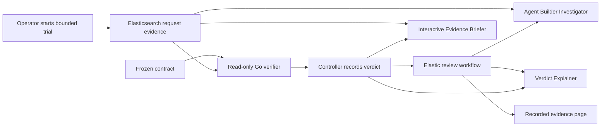

# Elastic integration

Elastic is part of the running SLOProof demo: Elasticsearch stores request
evidence and the deterministic verdict; Agent Builder investigates and explains
it; Workflows sequences the review. Go remains the sole decision engine.



The workflow runs **after** verification. It reads a separate deterministic
rollout policy, selects continued progression or a hold, and sends configured
Slack alerts for failed/inconclusive recovery. The operator-started runner owns
conditional stage execution; neither this workflow nor its agents patch routing
or issue verifier verdicts. Workflow completion is not an SLO pass.

See [the three rollout cases](../docs/ROLLOUT_CASES.md) for the 10/25/50/100 plan,
bounded evidence retries, live Slack receipt and remaining EKS validation gap.

## Directory guide

| Path | Role |
|---|---|
| `agents/` | Active Investigator, Verdict Explainer, and Evidence Briefer. The explainer retains legacy ID `sloproof_verifier`, but never decides verdicts. |
| `tools/` | Three read-only tools: bounded metrics, bounded completeness, and the recorded verdict. Metric tools use exact canonical query text. |
| `workflows/sloproof-loop.yaml` | Active manual outcome workflow. Requires one Go verdict and its matching deterministic policy; alerts precede advisory agents. |
| `rules/` | Disabled error-count signal, updated to client-observed requests. A candidate incident signal, not an SLO verdict; not installed by `manage.py`. |
| `connectors/` | Slack is active for the requested escalation to `#all-on-call-engineering-team`. The Lambda definition remains an unused reference. Secrets stay in Kibana. |
| `indices/` | Current creation bodies derived from `templates/`; not applied by this integration installer. |
| `templates/`, `queries/` | Canonical schemas and verifier queries. |
| `manage.py`, `kibana_client.py` | Installation, checks, workflow execution/collection, and Briefer questions. |
| Existing setup/key/migration scripts | Provisioning and independent ingest/verifier/controller credential checks. |

Original exports remain in the [archive](../docs/archive/elastic-agent-builder-20260918/README.md).
The active copies correct the earlier LLM decision path, unbounded trace queries
and automatic reversal. Unused prototype tools in Kibana are not deleted; the
active agents do not reference them.

## Run it

From the repository root, using the existing ignored `.env`:

```bash
.venv/bin/python -m pip install -r elastic/requirements.txt
.venv/bin/python elastic/manage.py validate
.venv/bin/python elastic/manage.py install
.venv/bin/python elastic/manage.py check demo-slow-20260918-02
.venv/bin/python elastic/manage.py run demo-slow-20260918-02 --attempt 3 --no-notify
# Collect after asynchronous completion; exit 2 means not completed:
.venv/bin/python elastic/manage.py collect demo-slow-20260918-02 --attempt 3
python3 scripts/render-evidence.py
```

Installation changes tools, agents and the manual workflow, with no cluster
changes. It saves old definitions in ignored `.local-scratch/` and disables the
old workflow first. A partial install leaves the old routing prototype disabled.

`run` refuses to overwrite a saved review: use `--attempt 2` and the same attempt
when collecting. `collect` checks execution/run identity, workflow hash and the
source decision. Local and remote verdict artifacts must match.

`run` first records the Go-derived rollout policy using the scoped controller
key. Native workflow input `notify` defaults to true; use `--no-notify` for a
silent replay. A replay with notifications enabled can send another real alert.
The failed-recovery Slack path was exercised and returned `ok: true`.

```bash
.venv/bin/python elastic/manage.py ask demo-slow-20260918-02 \
  'Why did this trial fail despite 100% candidate success? Should traffic automatically reverse?'
```

The Briefer command supplies the first recorded observation window and retains
the answer and tool calls. Use `--attempt 2` for another answer. In Kibana, choose
**SLOProof Evidence Briefer** in Agent Builder and supply the run ID and bounds.

Fresh trials start the native outcome workflow after recording the Go verdict
by default. Set `SLOPROOF_ELASTIC_REVIEW=0` to omit it or `SLOPROOF_SLACK=0` to
replay without messages. Collection is asynchronous. A review failure cannot
change the trial exit code or verdict.

## Credentials and models

Optional `.env` variables: `ELASTIC_KIBANA_ENDPOINT`, `ELASTIC_KIBANA_API_KEY`.
For Elastic Cloud the client can derive the Kibana endpoint and use the setup
key when no Kibana key is supplied. Secrets are not passed in command arguments.
Source-decision reads require `ELASTIC_VERIFIER_API_KEY` without an unscoped fallback.

Agent Builder and Workflows use the Kibana caller/workflow identity. Read-only
tool selection and workflow definitions constrain their interfaces; they do not
use the Go verifier's separate read-only identity. The 11 Elasticsearch scope
checks do not establish a separate Kibana credential for each agent. There is
no cryptographic attestation.

Agent Builder uses Elastic's configured model connector, identified in saved
execution metadata. Existing Python agents use Bedrock directly. This does not
establish an Agent Builder-to-Bedrock connection. Generated prose remains
fallible; the saved Go verdict and exact queries are authoritative.

## API references

- [Agent Builder and Workflows](https://www.elastic.co/docs/explore-analyze/ai-features/agent-builder/agents-and-workflows)
- [Workflow inputs](https://www.elastic.co/docs/explore-analyze/workflows/authoring-techniques/anatomy)
- [Conditional steps](https://www.elastic.co/docs/explore-analyze/workflows/steps/if)
- [Run a workflow](https://www.elastic.co/docs/api/doc/kibana/operation/operation-post-workflows-workflow-id-run)
- [Read an execution](https://www.elastic.co/docs/api/doc/kibana/operation/operation-get-workflows-executions-executionid)
